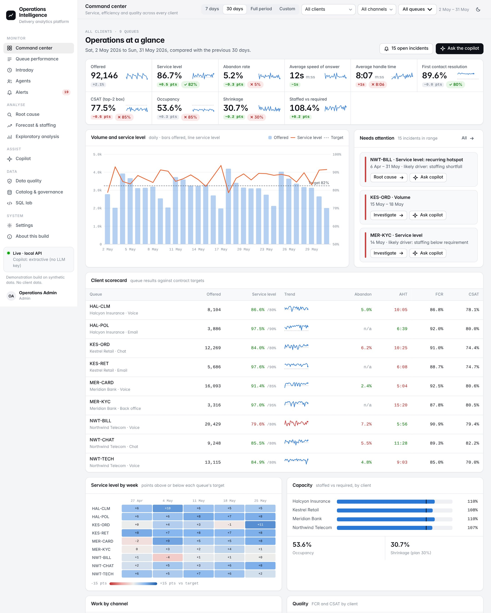
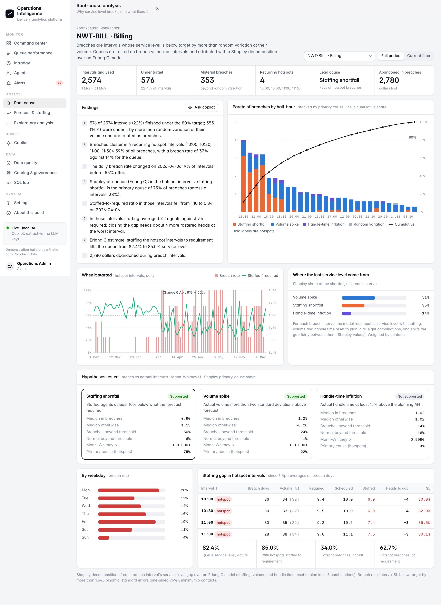
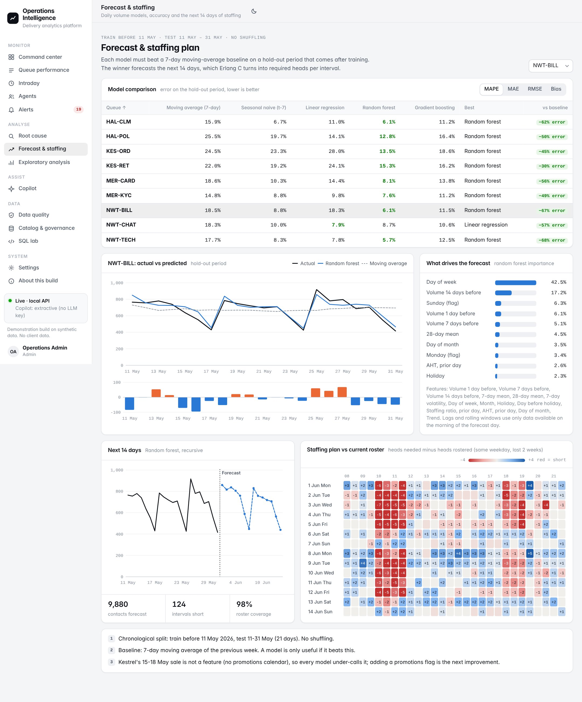
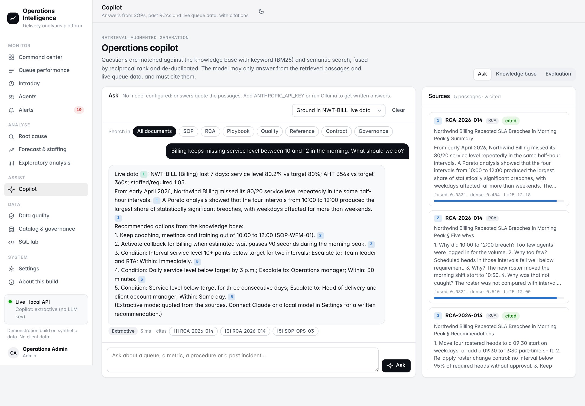
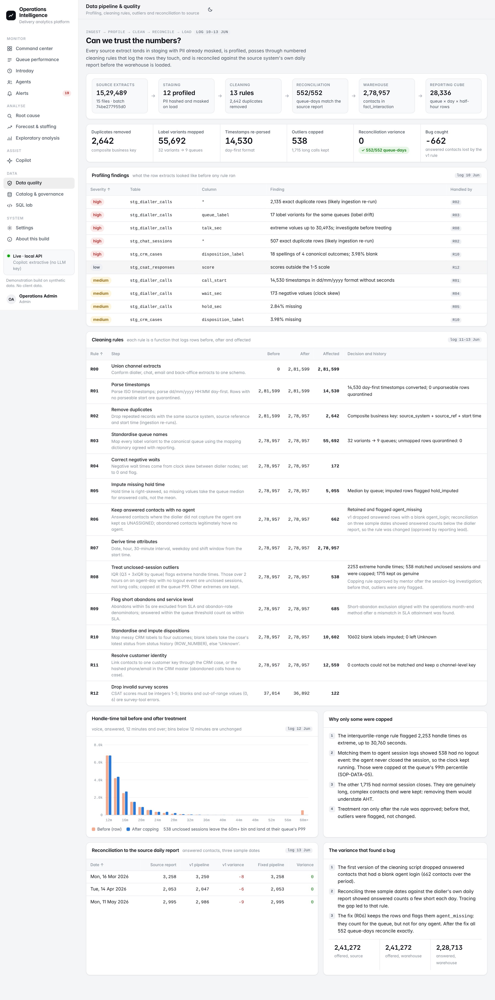
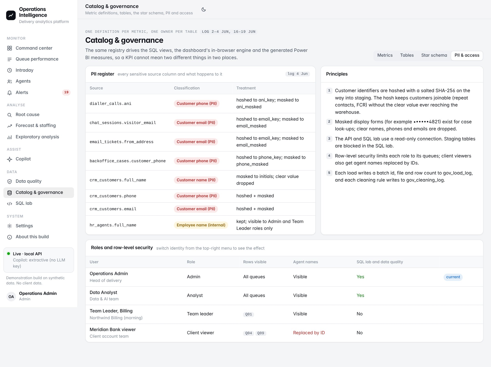

# Operations Intelligence Platform (OIP)

Contact-centre analytics, end to end. Messy extracts from a dialler, chat and email platforms, a back-office workflow, a CRM, workforce management and HR go in. Out come a masked and reconciled star schema, one agreed definition per KPI, a command centre with row-level security, an SLA root-cause workbench, a volume forecast with an Erlang C staffing plan, anomaly alerts, and a copilot that answers from SOPs and past RCAs with citations.

> **Reconstruction on synthetic data.** The Operations Intelligence Platform at BPO Integra India runs on confidential client data, and access ended with the internship on 30 June 2026. This repository was built afterwards for the internship review. It re-implements the methods worked on during the internship, under mentor supervision, on generated data for four fictional clients. It contains no company code and no client data.



## Quick start

```bash
git clone https://github.com/Sharank874/operations-intelligence-platform.git
cd operations-intelligence-platform
python -m venv .venv && source .venv/bin/activate      # Windows: .venv\Scripts\activate
pip install -r requirements.txt
python -m oip build      # generate sources → ingest → profile → clean → reconcile → warehouse → analytics → copilot index (about 2 min)
python -m oip serve      # http://127.0.0.1:8050      API docs: http://127.0.0.1:8050/api/docs
```

| Command | What it does |
|---|---|
| `python -m oip status` | Last build, row counts, reconciliation, retrieval quality, open incidents |
| `python -m oip ask "How do we handle an SLA breach in the morning peak?"` | Copilot from the terminal |
| `python -m oip export-powerbi [--with-facts]` | Star-schema CSVs, generated `measures.dax` and `MODEL.md` for Power BI Desktop |
| `python -m oip export-static` | `web/static/snapshot.js`, so the dashboard runs with no server (hosted preview) |
| `python -m pytest` | 40 tests: metric parity, cleaning rules, reconciliation, PII, Erlang C, RCA, forecast split, RLS, SQL guard rails, retrieval quality |

Optional: copy `.env.example` to `.env` and set `ANTHROPIC_API_KEY` (or run a local Ollama model) to have the copilot write its answers from the retrieved passages. Without a model it quotes the most relevant sentences, with the same citations.

## Results (reproducible)

Every figure below is produced by `python -m oip build` from the fixed seed (`20260601`) and was re-checked on a clean machine (Python 3.13, Linux) on 18 Oct 2026. `data/` is git-ignored because the build regenerates it.

| Check | Result | Where it comes from |
|---|---|---|
| Reconciliation to the source daily report | **552 / 552** queue-days match on offered and answered | `data/artifacts/reconciliation.json` |
| Replay of the old v1 cleaning rule | loses **662** answered contacts (blank agent login) | `reconciliation.json → v1_rule` |
| 14-day volume forecast, mean MAPE across queues | Random forest **9.33 %** vs seasonal-naive baseline 12.78 %, 7-day moving average 19.54 % | `data/artifacts/forecast.json` |
| Copilot retrieval, 32 questions, hybrid BM25 + LSA | hit@3 **1.00**, MRR **0.93**, citation accuracy **1.00** | `data/artifacts/rag_eval.json` |
| Test suite | **40 passed** | `python -m pytest` |

These numbers describe the method on designed synthetic data (see *Limitations*), not the performance of a real contact centre.

## Tech stack

Python 3.10+ · pandas · NumPy · SciPy · scikit-learn · SQLite + SQLAlchemy (star schema) · FastAPI + Uvicorn · vanilla JavaScript dashboard (no build step) · pytest · optional Claude API or Ollama for copilot answers · Power BI export (CSV + generated DAX)

## Screenshots

| Command centre | SLA root cause | Forecast & staffing |
|---|---|---|
|  |  |  |
| **Copilot with citations** | **Data quality** | **Governance & RLS** |
|  |  |  |

More in [`docs/screenshots/`](docs/screenshots). The internship report and review deck are in [`report/`](report).

## What it does

| Module | Question it answers | Method |
|---|---|---|
| **Data pipeline & quality** | Can we trust the numbers? | Batch-logged ingestion with salted SHA-256 hashing and masking of PII on load; column profiling; 13 numbered cleaning rules that log rows before, after and affected (de-duplication on a composite key, 32 queue-label variants → 9 queues, two timestamp formats, median imputation, disposition mapping, IQR outliers with approved capping of unclosed sessions); reconciliation to the source daily report (552/552 queue-days) and replay of the v1 rule that lost 662 answered contacts |
| **Warehouse & metric registry** | One definition per metric | SQLite star schema (7 dimensions, 6 facts), additive reporting cube at queue × day × half-hour, indexes, a metric registry in code that drives SQL, the dashboard engine and generated DAX |
| **Command center, queues, intraday, agents** | How are we doing, where, and when? | KPI tiles against target and previous period, client scorecard, weekly SL heatmap, interval heatmaps, staffing vs requirement, RANK() leaderboards, tenure effects, coaching flags |
| **Root cause** | Why does Billing miss SLA when the daily figure looks fine? | Interval-grain breach rule (binomial significance), Pareto, recurring-hotspot test, change-point detection, Mann–Whitney tests of staffing, volume and handle-time hypotheses, Shapley attribution over Erlang C, staffing gap and what-if |
| **Forecast & staffing** | How many contacts in the next 14 days, and how many agents? | Lag, rolling and calendar features; chronological split; moving-average and seasonal-naive baselines vs linear regression, random forest and gradient boosting (MAE, RMSE, MAPE, bias); recursive forecast; Erlang C interval plan with 30% shrinkage vs the current roster |
| **Alerts** | What changed that someone should look at? | Robust z-scores against a 28-day median/MAD (weekday-aware for volume), sustained seven-day shifts, RCA hotspots as incidents, one-click copilot recommendations |
| **Copilot** | What should the team leader do about it? | Markdown knowledge base (15 documents) → heading-aware chunks with context headers, tables rewritten as sentences, abbreviation expansion → LSA embeddings + BM25 → reciprocal-rank fusion → MMR → grounded answer with [n] citations and optional live queue data [L]; 32-question evaluation (hit@3 1.00, MRR 0.93, citation accuracy 1.00) |
| **Catalog & governance** | Who sees what, and what does each table mean? | Data catalog with sensitivity tags, star-schema diagram, PII register, four demo roles with row-level security (403 outside scope) and masked agent names for client viewers, read-only SQL lab with guard rails and execution plans |
| **Power BI export** | Same numbers in BI | CSVs, DAX measures generated from the registry (ratio of sums, MTD and previous month), model and RLS notes |

## Architecture

```
 SOURCE SYSTEMS (generated)     STAGING (SQLite)                CLEANING (pandas)              WAREHOUSE (SQLite)          SERVING
 ─────────────────────────      ───────────────────────         ───────────────────────        ───────────────────────     ──────────────────────────
 dialler / ACD calls       ─┐   15 stg_ tables, batch-logged    R00 union channels             dim_date  dim_interval      FastAPI (read-only, RLS)
 chat sessions              │   PII hashed + masked on load     R01 parse timestamps           dim_client dim_queue        ├─ dashboard (no build step)
 email tickets              ├─► profiling of every column  ─►   R02 de-duplicate          ─►   dim_agent dim_team_leader   ├─ copilot (RAG + citations)
 back-office cases          │                                   R03 map queue labels           dim_customer (masked)       ├─ SQL lab (guard rails)
 CRM cases, history, PII    │                                   R04–R12 waits, imputation,     fact_interaction            └─ OpenAPI docs
 WFM plan, staffed interval │                                   outliers, SLA flags,           fact_case_status            Power BI CSV + DAX
 HR roster, QA, CSAT       ─┘                                   dispositions, identity, CSAT   fact_csat fact_qa           offline snapshot
                                                                reconciliation to source       fact_wfm_interval
                                                                                               fact_agent_session
                                ANALYTICS: EDA · RCA (Pareto, tests, Shapley/Erlang C) ·       rpt_interval_cube (indexed)
                                forecast + staffing plan · anomalies · RAG index + eval        rpt_agent_day, rpt_queue_day
```

## The synthetic operation

Four fictional clients, nine queues, four channels, 1 March – 31 May 2026, about 279,000 contacts. Everything is seeded (`--seed 20260601`), so a build reproduces the same numbers.

| Client | Queue | Channel | Service level target |
|---|---|---|---|
| Northwind Telecom | NWT-BILL Billing, NWT-TECH Technical Support | Voice | 80% in 20 s |
| | NWT-CHAT Chat Care | Chat | 80% in 30 s |
| Halcyon Insurance | HAL-CLM Claims | Voice | 80% in 30 s |
| | HAL-POL Policy Servicing | Email | 90% in 4 h |
| Kestrel Retail | KES-ORD Orders | Chat | 80% in 45 s |
| | KES-RET Returns | Email | 90% in 4 h |
| Meridian Bank | MER-CARD Cards | Voice | 85% in 20 s |
| | MER-KYC KYC Back Office | Back office | 95% in 10 h |

The generator simulates arrivals with intraday, weekly, billing-cycle and holiday patterns; Erlang-style waits against a WFM plan with caller patience and abandonment; tenure effects on handle time; repeat contacts; CSAT and QA. It injects the defects a real extract has: label variants, re-exported duplicate rows, two date formats, negative waits from clock skew, missing hold time and dispositions, unclosed agent sessions, and clear PII in the CRM. Planted events the analytics must find:

- **Billing roster gap** from 6 April: a roster change moved the morning start to 10:30, leaving 10:00–12:00 and 18:00–19:30 under-staffed on weekdays.
- **Cards system latency**, 20–24 April: handle time up about a third.
- **Kestrel summer sale**, 15–18 May (orders chat) and returns emails a week later; the WFM forecast under-calls it.
- **Chat Care CSAT drop**, 23–29 March, after an app release.

## Metric definitions (short form)

Every ratio is stored as an additive numerator and denominator and divided last, so it re-aggregates correctly over any date range or queue set. The Catalog page lists all sixteen with SQL and DAX.

- **Service level** = answered within threshold ÷ (offered − abandons within 5 s); for email and back office, responded within threshold ÷ received
- **Abandon rate** = (abandoned − short abandons) ÷ (offered − short abandons), voice and chat
- **AHT** = (talk + hold + ACW) ÷ handled
- **FCR** = handled with no repeat from the same customer within 7 days ÷ handled (the last 7 days are excluded until mature)
- **CSAT** = responses scoring 4–5 ÷ responses
- **Occupancy** = handle time ÷ (staffed time × concurrency)
- **Shrinkage** = 1 − staffed ÷ scheduled
- **Staffed vs required** = staffed agents ÷ Erlang C required agents

## Project layout

```
oip/
  config.py, reference.py      paths, business rules, clients, queues, planted scenarios
  generate/synth.py            synthetic source systems with realistic defects
  pipeline/                    ingest (masking), profile, clean (rule log), reconcile
  warehouse/                   schema.sql, build.py, metrics.py (registry, DAX generation)
  analytics/                   erlang.py, eda.py, rca.py, forecast.py, anomaly.py
  copilot/                     kb/*.md, documents.py, index.py, answer.py, evaluate.py
  api/                         app.py (FastAPI), security.py (roles, RLS), sql_lab.py
  exports.py, catalog.py, cli.py
web/                           index.html, styles.css, js/ (core, charts, static, pages-*)
tests/                         pytest suite
docs/                          DESIGN.md, screenshots
```

## How this maps to the internship log

| Log dates | Work | Where it lives here |
|---|---|---|
| 1–4 Jun | Platform layers, metrics, data dictionary, governance | About, Catalog & governance |
| 5–9 Jun | SQL aggregation, joins and the one-to-many trap, CTEs, window functions, execution plans | SQL lab (12 saved queries) |
| 10–13 Jun | Extract, profiling, cleaning, outliers, reconciliation | `oip/pipeline`, Data quality page |
| 15 Jun | Exploratory analysis | Exploratory analysis page |
| 16–17 Jun | Metric SQL with exclusions, reporting views | `warehouse/metrics.py`, `rpt_interval_cube` |
| 18–22 Jun | Power BI star schema, DAX, queue page, testing, RLS | `export-powerbi`, Queue performance, tests |
| 23–24 Jun | SLA breach root-cause analysis | Root cause page |
| 25–26 Jun | Forecast features, baseline, models, metrics | Forecast & staffing page |
| 27–29 Jun | RAG knowledge base, embeddings, chunk-size test, citation tests | Copilot (Knowledge base, Evaluation) |

Modules that go beyond what the log records (intraday view, alerts, Shapley attribution, the staffing plan and answer generation) are marked as such on the About page.

## Limitations

- Synthetic data: patterns are realistic but designed, so findings demonstrate method, not results.
- Historical Data: Three months of history cannot capture annual seasonality; promotions are not yet a forecast feature.
- Infrastructure: SQLite suits a single-node demo. Production would use a server warehouse, scheduled orchestration (Airflow or similar) and SSO in front of the API.
- Offline Copilot: The offline copilot extracts sentences; it does not reason across documents. With a model it does, but every answer must still be checked against its citations.
